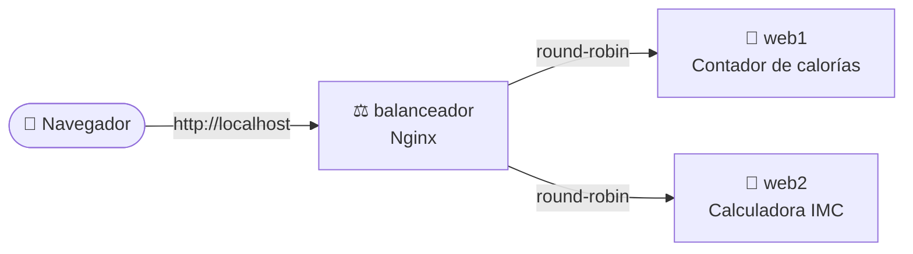

<div align="center">

# 🥗 NutriWeb

**Balanceo de carga con Docker y Nginx: dos servidores web, una sola aplicación nutricional**


*Práctica de la actividad **Despliegue de Aplicaciones Web** (DAW)*

</div>

---

## 📋 Índice

- [Descripción](#-descripción)
- [Arquitectura](#-arquitectura)
- [Los dos servidores](#-los-dos-servidores)
- [Estructura del proyecto](#-estructura-del-proyecto)
- [Puesta en marcha](#-puesta-en-marcha)
- [Comprobar el balanceo](#-comprobar-el-balanceo)
- [Cálculos y fuentes](#-cálculos-y-fuentes)
- [Autor](#-autor)

---

## 📖 Descripción

**NutriWeb** se despliega con **Docker Compose** en tres contenedores:

- Un **balanceador de carga Nginx**, que es el único punto de entrada.
- Dos **servidores web** (`web1` y `web2`), cada uno con una herramienta de nutrición distinta.

Cada vez que recargas la página, el balanceador te manda a uno de los dos servidores. Cada página indica en la cabecera en qué servidor estás, así que el reparto de peticiones se ve a simple vista. Las dos herramientas se complementan:

> 🧮 En el **Servidor 2** calculas cuántas calorías y macronutrientes necesitas al día.
> 🍎 En el **Servidor 1** sumas lo que vas a comer y lo comparas con esa cifra.

---

## 🏗️ Arquitectura



| Contenedor | Función | Contenido |
|---|---|---|
| `balanceador` | Proxy inverso y balanceo de carga | [balanceador/default.conf](balanceador/default.conf) |
| `web1` | Servidor web 1 | [web1/index.html](web1/index.html) |
| `web2` | Servidor web 2 | [web2/index.html](web2/index.html) |

Nginx reparte las peticiones por **round-robin**: una a cada servidor, por turnos.

---

## 🖥️ Los dos servidores

### 🍎 Servidor 1: contador de calorías

Marca los alimentos que vas a comer y la página suma en tiempo real las **calorías** y los **gramos de proteínas, hidratos y grasas**.

- **52 alimentos** organizados en frutas, verduras y tres grupos de macronutrientes, cada uno con su color:
  - 🔵 **Alimentos proteicos**
  - 🟡 **Hidratos de carbono**
  - 🟣 **Grasas**
- Dentro de cada grupo, los alimentos se separan en ✅ **saludables** y ⚠️ **poco saludables**.
- Cada alimento muestra su ración, sus kcal y sus etiquetas **P · H · G**.
- **Hecho solo con HTML y CSS, sin JavaScript.** La suma se hace con [contadores CSS](https://developer.mozilla.org/es/docs/Web/CSS/CSS_counter_styles/Using_CSS_counters): cada casilla guarda sus valores en variables CSS, y al marcarla los suma a los contadores.

```css
input:checked {
    counter-increment: total var(--kcal) proteinas var(--p) hidratos var(--h) grasas var(--g);
}
```

### 🧮 Servidor 2: calculadora de IMC y calorías diarias

Introduce tu sexo, edad, peso, altura y nivel de actividad física, y obtienes:

| Resultado | Cómo se calcula |
|---|---|
| **IMC** y su clasificación (OMS) | peso ÷ altura² |
| **Metabolismo basal** | Ecuación de Harris-Benedict, distinta para hombre y mujer |
| **Consumo diario recomendado** | Metabolismo basal × factor de actividad |
| **Reparto de macronutrientes** | 50 % hidratos · 20 % proteínas · 30 % grasas, en gramos y kcal |

---

## 📁 Estructura del proyecto

```
practica-docker-windows/
├── 📄 docker-compose.yml      # Define los tres contenedores
├── ⚖️ balanceador/
│   └── default.conf           # Configuración de Nginx (upstream + proxy)
├── 🍎 web1/
│   └── index.html             # Servidor 1: contador de calorías
├── 🧮 web2/
│   └── index.html             # Servidor 2: calculadora IMC
└── 📘 README.md
```

---

## 🚀 Puesta en marcha

### Requisitos

- [Docker Desktop para Windows](https://www.docker.com/products/docker-desktop/), abierto y en ejecución
- Git

### Pasos

```powershell
# 1. Clonar el repositorio
git clone https://github.com/jramonnv0786-prog/practica-docker-windows.git
cd practica-docker-windows

# 2. Levantar los contenedores en segundo plano
docker compose up -d

# 3. Comprobar que los tres contenedores están en marcha
docker compose ps
```

Abre **http://localhost** en el navegador. 🎉

Para detenerlo todo:

```powershell
docker compose down
```

---

## 🔁 Comprobar el balanceo

**Desde el navegador:** recarga la página varias veces (`Ctrl + F5`). La cabecera irá alternando entre **«Estás en el SERVIDOR 1»** y **«Estás en el SERVIDOR 2»**.

**Desde PowerShell:** lanza 6 peticiones seguidas y mira qué servidor responde a cada una:

```powershell
1..6 | ForEach-Object {
    $html = (Invoke-WebRequest http://localhost -UseBasicParsing).Content
    if ($html -match 'SERVIDOR \d') { $Matches[0] }
}
```

Resultado esperado:

```
SERVIDOR 1
SERVIDOR 2
SERVIDOR 1
SERVIDOR 2
...
```

---

## 🔬 Cálculos y fuentes

### Ecuación de Harris-Benedict (revisión de Roza y Shizgal, 1984)

| Sexo | Metabolismo basal (kcal/día) |
|---|---|
| 👨 Hombre | 88,362 + 13,397 × peso (kg) + 4,799 × altura (cm) − 5,677 × edad (años) |
| 👩 Mujer | 447,593 + 9,247 × peso (kg) + 3,098 × altura (cm) − 4,330 × edad (años) |

### Factores de actividad

| Nivel | Factor |
|---|---|
| Sedentario | × 1,2 |
| Ligero (1-3 días/semana) | × 1,375 |
| Moderado (3-5 días/semana) | × 1,55 |
| Intenso (6-7 días/semana) | × 1,725 |
| Muy intenso | × 1,9 |

### Clasificación del IMC (OMS)

| IMC | Clasificación |
|---|---|
| < 18,5 | Bajo peso |
| 18,5 - 24,9 | Peso normal |
| 25 - 29,9 | Sobrepeso |
| 30 - 34,9 | Obesidad grado I |
| 35 - 39,9 | Obesidad grado II |
| ≥ 40 | Obesidad grado III |

### Datos de los alimentos

- Las calorías y los macronutrientes del Servidor 1 salen de **[USDA FoodData Central (SR Legacy)](https://fdc.nal.usda.gov/)**, la base de datos de composición de alimentos del Departamento de Agricultura de EE. UU. Para cada ración se toma el valor por 100 g y se ajusta al peso de la ración.
- El queso fresco batido 0 % y el refresco de cola usan los valores de su etiqueta.
- El reparto de macronutrientes del Servidor 2 está dentro de los rangos de referencia de la **EFSA** y del **Institute of Medicine**: hidratos 45-60 %, proteínas 10-35 % y grasas 20-35 % de la energía diaria.

> ⚠️ **Aviso:** NutriWeb es un proyecto educativo. Los valores son medias de referencia y no sustituyen el consejo de un profesional de la nutrición.

---

## 👤 Autor

Desarrollado por **[jramonnv0786-prog](https://github.com/jramonnv0786-prog)** como práctica de *Despliegue de Aplicaciones Web*.

<div align="center">

⭐ Si te ha resultado útil, ¡dale una estrella al repositorio!

</div>
